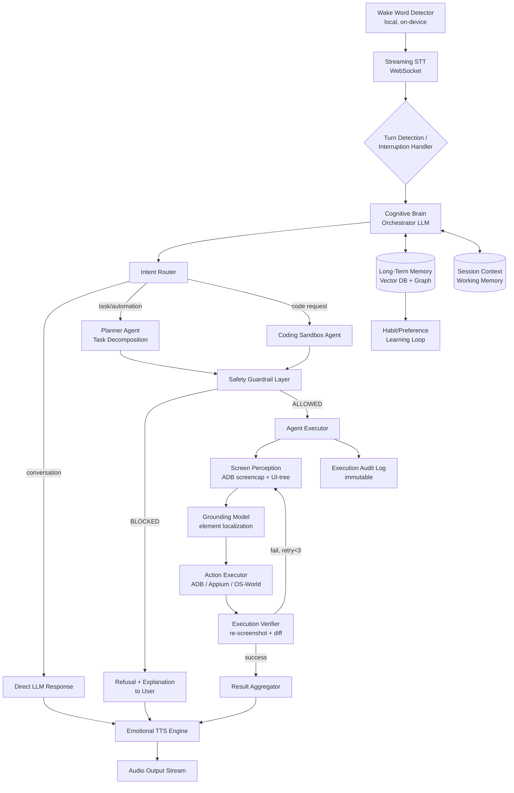

# NEXUS — Autonomous AI Assistant (JARVIS-Class) Technical Blueprint

**Version:** 1.0 | **Date:** July 2026 | **Classification:** Production-Grade Architecture Document

---

## 1. System Architecture

### 1.1 High-Level Flow (Mermaid)



### 1.2 Layer Responsibilities

| Layer | Responsibility | Latency Budget |
|---|---|---|
| Wake/VAD | Local wake-word + voice-activity detection | <50ms |
| STT | Streaming transcription | <150–300ms TTFB |
| Orchestrator LLM | Reasoning, routing, tool-call planning | 300–800ms first token |
| Safety Guardrail | Policy check on every planned action | <50ms (rule engine) + async LLM classifier |
| Perception | Screen capture + UI-tree/XML extraction | 100–400ms |
| Grounding | Map instruction → screen coordinates | 150–500ms (cached when possible) |
| Executor | ADB/Appium action dispatch | 50–200ms per action |
| TTS | Streaming synthesis | <150–250ms TTFB |

The **Safety Guardrail sits between planning and execution on every single action**, not just once per session — this is non-negotiable for a system with device control.

---

## 2. Technology Stack (2026 landscape)

### 2.1 Cognitive Brain / Orchestration
- **Primary LLM:** Claude (via Anthropic API) or GPT-5.x for reasoning + native tool/function calling and vision (screen understanding). Use a cheaper/faster model (Haiku-class) for the routing/classification hop, and a frontier model only for planning/complex reasoning — a **model cascade**, not one model for everything.
- **Agent Framework:** <cite index="5-1">LangGraph 1.0 for complex, durable, stateful workflows with per-node timeouts and streaming</cite>, or the **Claude Agent SDK**, which <cite index="5-1">added hierarchical subagent spawning and fallback model chains in June 2026</cite> — a strong fit for an Anthropic-native production agent like this. <cite index="4-1">CrewAI remains the fastest path if you want role-based agents (e.g., "Perception Agent," "Planner Agent," "Coder Agent") with a low barrier to entry</cite>.
- Recommendation: **LangGraph** as the durable state machine/orchestrator (handles retries, human-in-the-loop approval nodes, checkpointing) wrapping specialized sub-agents.

### 2.2 Voice I/O
- **STT:** <cite index="11-1">Real-time speech recognition needs first partial results under 500ms to feel instantaneous</cite>. <cite index="10-1">ElevenLabs Scribe v2 Realtime targets around 150ms latency over WebSockets</cite>; <cite index="12-1">Deepgram ships a dedicated voice-agent turn-taking model called Flux</cite>. Pick based on language coverage vs. raw latency needs.
- **TTS (JARVIS persona voice):** <cite index="13-1">Cartesia (sub-150ms), Rime (sub-200ms), and Deepgram Aura (under 250ms) are top 2026 candidates for streaming, conversational-prosody TTS</cite>. Use voice cloning/custom-voice design for a consistent "JARVIS" timbre, and drive **prosody/emotion via SSML tags controlled by the LLM's inferred emotional state** (calm/urgent/playful).
- For a single-socket simplified pipeline, <cite index="15-1">bundled STT+LLM+TTS voice-agent APIs exist that replace separate providers with one WebSocket connection</cite> — trade flexibility for lower integration complexity.

### 2.3 OS/Device Control
- **Android:** ADB (raw shell + `input tap/swipe/text`, `am start`, `dumpsys`), **Appium** for higher-level, more robust UI-tree-based interaction (accessibility tree > pixel guessing), **UIAutomator2** driver.
- **PC:** OS-World-style frameworks (screenshot + accessibility API + synthetic input), PyAutoGUI for simple cases, native Win32/AppKit accessibility APIs for robust element targeting.
- **Grounding model:** a vision-language model fine-tuned for GUI grounding (e.g., a screen-parsing model that converts screenshot → structured element list with bounding boxes) rather than relying on the general LLM to guess pixel coordinates from a raw image — this is the single biggest reliability lever.

### 2.4 Memory
- **Vector DB:** Qdrant, Weaviate, or Milvus for semantic recall (preferences, past conversations, codebase embeddings).
- **Graph layer:** a lightweight knowledge graph (Neo4j or even a structured SQLite schema) for **relational facts** ("user's banking apps," "user's coding projects," "user's daily routine") that vector search alone handles poorly.
- **Tiered memory:** working memory (last N turns, in context) → episodic memory (session summaries, vector-indexed) → semantic memory (long-term facts/preferences, graph + vector hybrid).

### 2.5 Guardrails
- Deterministic **rule-based allow/deny list** (fast, auditable) as the first gate, backed by an LLM-based intent classifier as a second gate for ambiguous cases, plus **human-in-the-loop confirmation** for any irreversible or sensitive action.

---

## 3. Step-by-Step Implementation Roadmap

### Phase 0 — Foundations (Weeks 1–2)
- Define the **action ontology**: enumerate every category of action the system will ever be allowed to take (send message, open app, adjust setting, write file, run code, etc.) and pre-classify each as `safe-auto`, `confirm-required`, or `forbidden`.
- Stand up the **audit-log database** (append-only) before writing a single agent — every action, every decision, every guardrail check gets logged from day one.
- Set up ADB over a dedicated test device (never your primary phone) with `adb tcpip` for wireless debugging.

### Phase 1 — MVP: Voice-in, Text-out Assistant (Weeks 3–5)
- Wire STT → LLM → TTS as a plain conversational loop, no device control yet.
- Implement wake-word detection (local, e.g., Porcupine) and streaming turn-taking.
- Add short-term (in-context) memory only. No vector DB yet.
- **Exit criteria:** sub-1.5s round-trip voice conversation latency, stable on 30-min sessions.

### Phase 2 — Long-Term Memory (Weeks 6–8)
- Integrate vector DB; embed and store conversation summaries nightly (not every raw message — summarize first).
- Add preference extraction: a background job that periodically mines conversation history for stable facts ("prefers concise answers," "works in Python," "sleeps at 11pm") and writes them to the graph layer.
- Add tone/sentiment detection on STT output to modulate TTS emotional register.

### Phase 3 — Read-Only Device Perception (Weeks 9–11)
- Add ADB screen capture + UI-tree dump. LLM can *describe* what's on screen and answer questions about it. **No write actions yet.** This isolates perception bugs from action bugs.
- Build the grounding pipeline (screenshot → structured element list) and benchmark accuracy before allowing any tap/type actions.

### Phase 4 — Guardrail Layer (Weeks 12–13)
- Build the deterministic allow/deny rule engine and the LLM safety classifier.
- Hard-code the **banking/financial app exclusion list** (package names) plus a fallback heuristic (app category / permission scan) to catch apps not on the static list.
- Build the human-in-the-loop confirmation flow (voice or push notification) for `confirm-required` actions.
- **This phase gates everything after it — do not proceed to Phase 5 until guardrails have their own test suite with adversarial prompts.**

### Phase 5 — Autonomous Action Execution (Weeks 14–17)
- Enable write actions (tap, type, swipe, launch app) behind the guardrail, starting with a small whitelist of apps (e.g., Messages, Camera, Settings brightness).
- Implement the **execution verifier**: after every action, re-screenshot and diff against expected state; retry with backoff (max 3 attempts) before escalating to the user.
- Expand whitelist incrementally, app by app, with logged success/failure rates per app before adding the next.

### Phase 6 — Multi-Agent Coding Sandbox (Weeks 18–22)
- Stand up an isolated, network-restricted container (Docker, gVisor, or Firecracker microVM) as the code execution sandbox — **never execute generated code on the host or the controlled phone directly.**
- Build the Coder Agent → Test Agent → Reviewer Agent loop (LangGraph subgraph): write code, run tests in sandbox, self-critique, iterate.
- Add optional "deploy to device" step only after tests pass in sandbox, and only for pre-approved deployment targets.

### Phase 7 — Hardening & NEXUS State (Weeks 23–26+)
- Load-test voice pipeline at concurrency; add graceful degradation states (e.g., fallback to text if TTS latency spikes).
- Red-team the guardrail layer specifically: prompt-injection via screen content, social-engineering phrasing, indirect requests ("open my budgeting app" where budgeting app touches banking).
- Add continuous evaluation harness (regression tests replaying real session transcripts) so future model/prompt changes can't silently regress safety behavior.
- Formalize the memory-decay/consolidation job (merge duplicate facts, expire stale preferences) to keep the vector index from growing unbounded and drifting.

---

## 4. Code Blueprint (Python)

```python
"""
NEXUS core loop (simplified, illustrative):
voice command -> safety-gated LLM planning -> ADB execution
"""

import subprocess
import json
import logging
from dataclasses import dataclass
from enum import Enum
from anthropic import Anthropic

logging.basicConfig(level=logging.INFO)
logger = logging.getLogger("nexus.core")

client = Anthropic()  # API key handled via environment

# --------------------------------------------------------------------------
# 1. SAFETY LAYER — deterministic, checked BEFORE any LLM-generated action
# --------------------------------------------------------------------------

FORBIDDEN_PACKAGE_SUBSTRINGS = [
    "bank", "chase", "wellsfargo", "paypal", "venmo", "cashapp",
    "coinbase", "robinhood", "revolut", "creditkarma", "mint",
    "americanexpress", "capitalone", "schwab", "fidelity",
]

CONFIRM_REQUIRED_ACTIONS = {"delete_app", "factory_reset", "send_message",
                             "make_call", "install_app", "uninstall_app"}


class GuardrailDecision(Enum):
    ALLOW = "allow"
    CONFIRM = "confirm"
    BLOCK = "block"


@dataclass
class PlannedAction:
    action_type: str          # e.g. "adb_tap", "adb_type", "launch_app"
    target_package: str | None
    payload: dict


def check_guardrail(action: PlannedAction) -> GuardrailDecision:
    """Deterministic first gate. Runs in microseconds, no LLM call."""
    pkg = (action.target_package or "").lower()

    if any(term in pkg for term in FORBIDDEN_PACKAGE_SUBSTRINGS):
        logger.warning(f"BLOCKED: action against forbidden package {pkg}")
        return GuardrailDecision.BLOCK

    if action.action_type in CONFIRM_REQUIRED_ACTIONS:
        return GuardrailDecision.CONFIRM

    return GuardrailDecision.ALLOW


def llm_safety_classifier(user_request: str, action: PlannedAction) -> bool:
    """Second gate: catches semantic attempts to route around the
    static blocklist (e.g., a banking app not yet on the list)."""
    resp = client.messages.create(
        model="claude-sonnet-5",
        max_tokens=200,
        system=(
            "You are a strict safety classifier for a device-automation "
            "agent. Answer ONLY 'SAFE' or 'UNSAFE'. Mark UNSAFE if the "
            "action touches financial/banking apps, irreversible system "
            "changes, or anything not clearly requested by the user."
        ),
        messages=[{
            "role": "user",
            "content": f"User request: {user_request}\n"
                       f"Planned action: {json.dumps(action.__dict__)}"
        }],
    )
    verdict = resp.content[0].text.strip().upper()
    return verdict == "SAFE"


# --------------------------------------------------------------------------
# 2. PLANNER — natural language -> structured action via tool calling
# --------------------------------------------------------------------------

TOOLS = [{
    "name": "adb_action",
    "description": "Perform a single ADB action on the connected Android device.",
    "input_schema": {
        "type": "object",
        "properties": {
            "action_type": {"type": "string",
                             "enum": ["tap", "type", "launch_app", "swipe", "key_event"]},
            "target_package": {"type": "string",
                                "description": "Android package name, if applicable"},
            "x": {"type": "integer"}, "y": {"type": "integer"},
            "text": {"type": "string"},
        },
        "required": ["action_type"],
    },
}]


def plan_action_from_voice(transcript: str) -> PlannedAction:
    resp = client.messages.create(
        model="claude-sonnet-5",
        max_tokens=500,
        tools=TOOLS,
        system="You control an Android phone via ADB for the user. "
               "Never touch financial or banking apps. Propose exactly "
               "one action per request.",
        messages=[{"role": "user", "content": transcript}],
    )
    for block in resp.content:
        if block.type == "tool_use":
            args = block.input
            return PlannedAction(
                action_type=args["action_type"],
                target_package=args.get("target_package"),
                payload=args,
            )
    raise ValueError("No actionable tool call produced")


# --------------------------------------------------------------------------
# 3. EXECUTOR — actually talks to the device over ADB
# --------------------------------------------------------------------------

def execute_adb_action(action: PlannedAction) -> str:
    p = action.payload
    if action.action_type == "launch_app":
        cmd = ["adb", "shell", "monkey", "-p", action.target_package,
               "-c", "android.intent.category.LAUNCHER", "1"]
    elif action.action_type == "tap":
        cmd = ["adb", "shell", "input", "tap", str(p["x"]), str(p["y"])]
    elif action.action_type == "type":
        safe_text = p["text"].replace(" ", "%s")
        cmd = ["adb", "shell", "input", "text", safe_text]
    elif action.action_type == "swipe":
        cmd = ["adb", "shell", "input", "swipe",
               str(p["x1"]), str(p["y1"]), str(p["x2"]), str(p["y2"])]
    else:
        raise ValueError(f"Unsupported action_type: {action.action_type}")

    result = subprocess.run(cmd, capture_output=True, text=True, timeout=10)
    logger.info(f"ADB executed: {cmd} -> rc={result.returncode}")
    return result.stdout


# --------------------------------------------------------------------------
# 4. ORCHESTRATION — ties it together with full audit logging
# --------------------------------------------------------------------------

def handle_voice_command(transcript: str, request_confirmation_fn=None) -> str:
    logger.info(f"USER TRANSCRIPT: {transcript}")

    action = plan_action_from_voice(transcript)
    decision = check_guardrail(action)

    if decision == GuardrailDecision.BLOCK:
        return ("I can't do that — it involves a financial or banking "
                "app, which is outside what I'm allowed to touch.")

    if decision == GuardrailDecision.CONFIRM:
        if request_confirmation_fn is None or not request_confirmation_fn(action):
            return "Okay, I won't proceed without your confirmation."

    if not llm_safety_classifier(transcript, action):
        logger.warning(f"LLM safety classifier rejected action: {action}")
        return "That action didn't pass my safety check, so I've stopped short."

    output = execute_adb_action(action)
    logger.info(f"AUDIT: transcript='{transcript}' action={action} output={output!r}")
    return f"Done — executed {action.action_type} on {action.target_package or 'device'}."


if __name__ == "__main__":
    # Example: "Open WhatsApp" is allowed; "Open my Chase banking app" is blocked.
    print(handle_voice_command("Open WhatsApp for me"))
```

**Key design choices in this blueprint:**
- Two independent safety gates (deterministic + LLM) — never rely on the LLM alone to refuse.
- Every planned action passes through `check_guardrail` **before** the LLM's semantic classifier runs, so blocklist hits never even spend an API call.
- Full audit logging of transcript → planned action → decision → output, for post-hoc review and eval-set construction.
- `request_confirmation_fn` is a hook — in production this triggers a push notification or spoken "Should I proceed?" and blocks on the user's reply.

---

## 5. Critical Engineering Challenges

### 5.1 Screen-Parsing Latency
- **Problem:** vision-model-based screen understanding on every action is slow (multi-second) and expensive.
- **Solutions:**
  - Prefer the **Android accessibility/UI-tree dump** (`uiautomator dump` or Appium's page source) over raw screenshots whenever available — it's structured text, parses in milliseconds, and is far more reliable than pixel-based grounding.
  - Reserve vision-model screenshot analysis for apps/screens where no accessibility tree is exposed (custom-rendered UIs, games, some canvas-based apps).
  - **Cache UI layouts** per app screen (hash the view hierarchy) so repeat navigation to a known screen skips re-parsing.
  - Run perception and planning **concurrently** where possible (e.g., prefetch the next likely screen state while executing the current action) rather than strictly serially.

### 5.2 Context-Window Management for Long-Term Memory
- **Problem:** naive approaches either blow the context window with full history or lose important long-tail facts.
- **Solutions:**
  - **Tiered summarization**: raw turns → rolling session summary (every ~20 turns) → long-term fact extraction (nightly batch job) → only the extracted facts + a short recent-session summary go into the live context, not raw transcripts.
  - **Retrieval, not replay**: at query time, embed the current user request and pull only the top-k most relevant memory items from the vector DB, rather than stuffing all known facts into every prompt.
  - **Fact decay/versioning**: preferences and habits change; store facts with timestamps and confidence scores, and let newer contradicting facts supersede older ones rather than accumulating stale, conflicting memory.
  - **Separate memory namespaces** per domain (coding preferences vs. personal habits vs. app-usage patterns) so retrieval doesn't have to search irrelevant partitions.

### 5.3 Local Code-Execution Safety
- **Problem:** an agent that writes and runs code on your behalf is a direct path to arbitrary code execution if compromised or misled.
- **Solutions:**
  - **Sandbox everything**: run generated code exclusively in an ephemeral, network-egress-restricted container (Firecracker microVM or gVisor) with a hard resource ceiling (CPU/memory/time) and no access to host credentials or the controlled device's ADB session.
  - **Static analysis pre-execution**: scan generated code for dangerous patterns (shell-outs, network calls, filesystem access outside a scratch dir, `eval`/`exec`) and require explicit confirmation before running anything flagged.
  - **No credential injection**: the sandbox never receives real API keys, banking-adjacent tokens, or device-control credentials — it only gets synthetic/test fixtures.
  - **Promote, don't auto-deploy**: code only reaches the real device or production environment through an explicit, logged "promote" step after passing tests in the sandbox — the coding agent never has direct write access to production or the phone.

---

*This is an architecture and planning document. Building the device-control and code-execution layers responsibly requires careful, incremental rollout — Phase 4 (guardrails) is intentionally sequenced before any write-capable action execution.*
